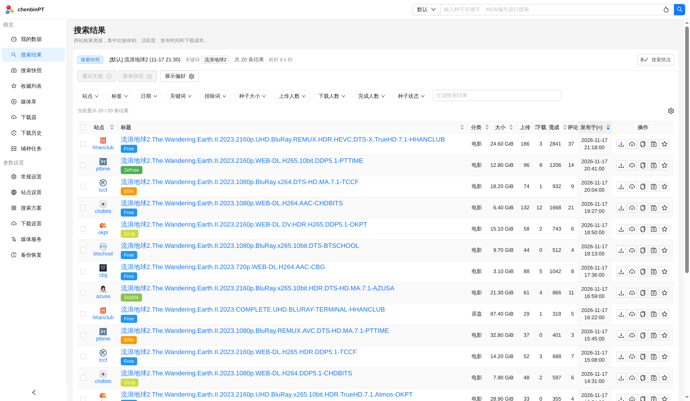
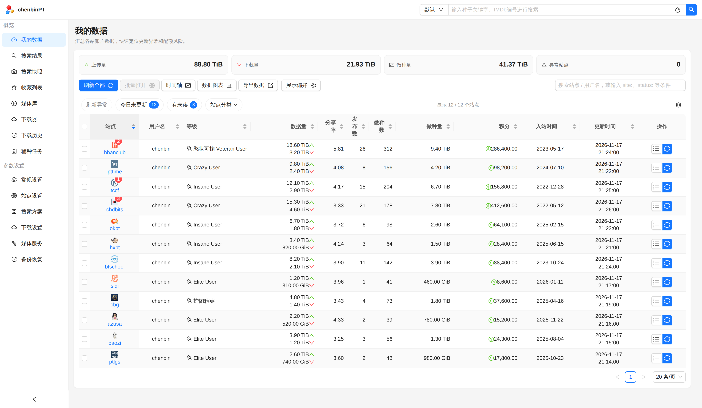
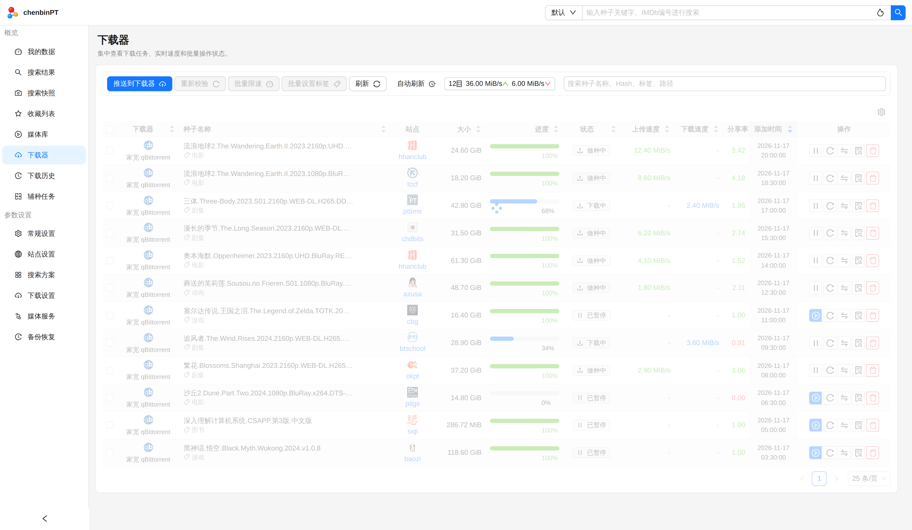
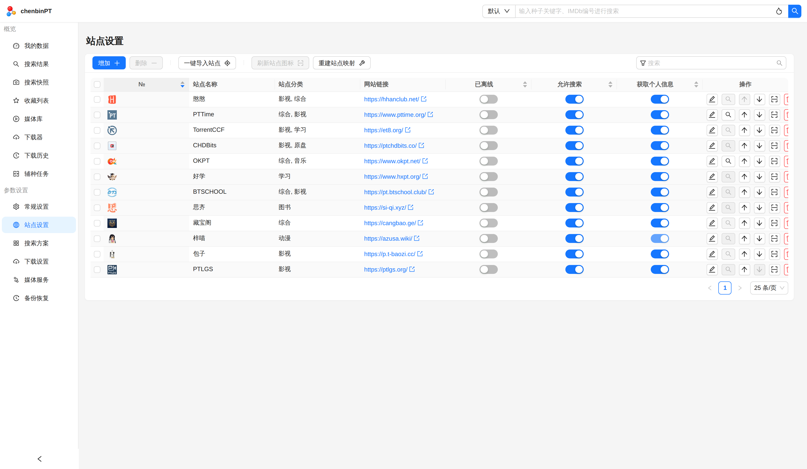
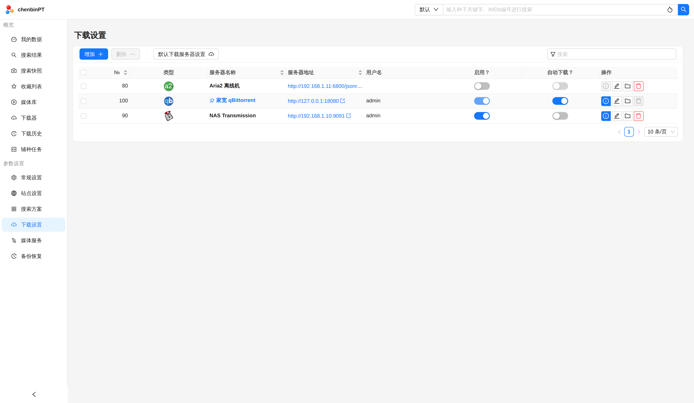

<p align="center">
  
</p>

<h1 align="center">chenbinPT</h1>

<p align="center"><strong>把多个 PT 站点，装进一个浏览器页面。</strong></p>

<p align="center">聚合搜索 · 账号数据看板 · 一键推送下载 · 辅种 · 媒体库查重 · 备份恢复</p>

<p align="center">
  <a href="https://github.com/chenbin3625/chenbinPT/releases/latest"></a>
  
  
  <a href="./LICENSE"></a>
</p>



chenbinPT 是一款浏览器扩展，把日常 PT 操作集中到一个界面：一次搜索多个站点、汇总各站账号数据、把选中的种子直接推送到下载器，并支持辅种、媒体库查重、站点页面助手与加密备份。不用再在几十个站点标签页之间来回切换。

> 适用人群：已经在使用 PT 站点、希望少开标签页、少手动复制链接、想集中查看账号状态的朋友。

[功能](#功能一览) · [界面预览](#界面预览) · [安装](#安装) · [五分钟上手](#五分钟上手) · [常见问题](#常见问题) · [数据与隐私](#数据与隐私)

---

## 功能一览

### 🔍 一次搜索，多个站点

- 输入一次关键词，按搜索方案同时搜索多个已添加的站点。
- 支持站点、分类、免费、发布时间、体积、做种/下载人数等筛选与排序。
- 结果可以直接单条或批量推送到下载器，推送时可指定保存路径、标签和是否暂停开始。
- 可以把常用站点组合保存为「搜索方案」，例如「电影站」「综合站」「追剧专用」。
- 搜索结果可以保存为「搜索快照」，之后随时回看，不用重新搜索。

### 📊 我的数据

- 集中查看各站的上传量、下载量、分享率、做种数、做种体积、积分、等级、入站时间。
- 一键刷新全部站点，也可以只刷新勾选或当前筛选出的站点。
- 「刷新异常」「今日未更新」「有未读」快捷筛选，哪个站出问题一眼就能看到。
- 提供时间线、数据图表与历史数据查看，可导出 CSV / JSON。
- 显示等级要求与下一等级差距，方便判断什么时候该多保种。

### ⬇️ 下载器

- 支持 qBittorrent、Transmission、Deluge、Aria2、ruTorrent、uTorrent、Synology Download Station、Flood。
- 在扩展里查看任务列表、实时上下行速度、进度、分享率、保存路径。
- 支持暂停、继续、校验、删除、限速、打标签、调整队列等常用操作。
- 多个下载器可以同时管理，也可以在搜索结果里指定推送到哪一个。

### 🌱 辅种任务

- 把已有的种子重新添加到下载器继续做种，支持批量处理。
- 可为辅种任务单独指定下载器和保存路径，不影响日常下载。

### 🎬 媒体库查重

- 连接 Emby、Jellyfin、Plex 或 fnOS 媒体服务器。
- 搜索前先查媒体库，减少重复下载；也可以浏览媒体库条目的播放状态。
- 支持查看媒体库概览，了解当前收藏规模。

### 🧩 站点页面助手

- 在已添加的 PT 站点页面显示悬浮入口，不用离开站点就能搜索、查看账号、下载当前种子。
- 支持把页面上的链接拖到悬浮入口，直接推送到下载器。
- 站点列表页可以批量下载或推送，并提供更顺手的列表增强。

### 💾 备份与恢复

- 支持导出/导入本地备份文件，也可以备份到 WebDAV、S3 兼容存储、Dropbox、Google Drive、Gist 等远端位置。
- 可自定义备份内容：插件配置、站点与下载器配置、用户信息、下载历史、辅种任务、收藏、搜索快照等。
- 支持设置加密密钥与自动备份计划；未设置密钥时，含敏感字段的备份不会上传到远端。
- 换电脑或重装浏览器时，用备份就能把配置带过去。

### 📚 另外还有

- **收藏列表**：收藏感兴趣的种子，之后统一查看。
- **下载历史**：记录每次推送的结果，失败时能看到原因。
- **媒体信息**：支持用豆瓣、IMDb 等链接直接搜索相关种子，并展示 Bangumi、TMDB、TVMaze 等来源的条目信息。
- **右键菜单 / 地址栏搜索**：在网页上选中文字或链接即可搜索、推送。
- **深色模式与页面缩放适配**：跟随系统主题，长时间使用更舒服。

---

## 界面预览

| 我的数据 | 下载器 |
| --- | --- |
| [](./screenshots/01-my-data.png) | [](./screenshots/03-my-client.png) |
| **站点设置** | **下载设置** |
| [](./screenshots/04-sites.png) | [](./screenshots/05-downloaders.png) |

> 截图中的站点、账号与下载任务均为演示数据。

---

## 安装

### 从 Release 安装（推荐）

1. 打开 [最新版本](https://github.com/chenbin3625/chenbinPT/releases/latest)，下载对应浏览器的压缩包：
   - **Chrome / Edge**：`extension-chrome.zip`
   - **Firefox**：`extension-firefox.zip`
2. 解压到一个固定目录（以后升级时覆盖同一个目录，配置不会丢）。
3. 加载扩展：
   - **Chrome**：打开 `chrome://extensions`，开启右上角「开发者模式」，点「加载已解压的扩展程序」，选择解压后的目录。
   - **Edge**：打开 `edge://extensions`，开启「开发人员模式」，点「加载解压缩的扩展」，选择解压后的目录。
   - **Firefox**：打开 `about:debugging#/runtime/this-firefox`，点「临时载入附加组件」，选择解压目录里的 `manifest.json`。
4. 建议把 chenbinPT 固定到工具栏，点击图标即可打开管理页面。

**版本要求**：Chrome / Edge 140 及以上，Firefox 133 及以上。

> Firefox 的「临时载入」在浏览器重启后会失效，需要重新载入一次。如果希望长期使用，建议使用 Chrome / Edge 版本，或自行对 Firefox 版本做永久安装。

### 升级

下载新版压缩包，解压覆盖原目录，然后在扩展管理页点击「重新加载」。站点配置、账号数据与下载历史都会保留。

---

## 五分钟上手

### 1. 添加站点

打开扩展 → **站点设置** → **增加**，从内置站点列表中选择你正在使用的站点。也可以使用「一键导入站点」批量添加。

- 大多数站点会复用浏览器里已有的登录状态，先在浏览器登录站点即可。
- 部分站点要求填写 `passkey`、`authkey`、API Key 或 Cookie，按站点提示填写。
- 添加完成后，可以在站点设置里看到站点图标、分类、地址和是否允许搜索/获取个人信息。

### 2. 添加下载器

**下载设置** → **增加** → 选择下载器类型 → 填写地址、用户名和密码 → 保存。

- qBittorrent 请确认已开启 WebUI，并允许本机或局域网访问。
- qBittorrent 5.2 及以上可以使用 API Key：用户名留空，密码填 API Key。
- 添加后点「默认下载服务器设置」，选择日常使用的下载器和默认保存路径。

### 3. 搜索并推送

在顶部搜索框输入关键词，选择搜索方案，回车或点击搜索。进入结果页后：

- 用上方的筛选条缩小范围（站点、免费、体积、做种人数等）。
- 勾选想要的种子，点「推送到下载器」；也可以直接点单行的下载/推送按钮。
- 如果还没配置下载器，可以先把种子下载到本地。

### 4. 查看账号数据

**我的数据** → **刷新全部**。之后每次打开扩展都会显示最近一次的数据，也可以单独刷新某个站点。点击行内的「时间线」或「数据图表」可以查看变化趋势。

### 5. 设置备份

**备份恢复** → 先在「常规设置 → 备份」里设置一个加密密钥（建议使用随机生成的密钥），再添加备份位置。

- 只想备份到本机：使用「本地导出」。
- 想自动备份到 NAS 或网盘：添加 WebDAV、S3 等远端位置，并设置自动备份间隔。
- 密钥不会随备份上传，请单独保管；密钥丢失后加密备份无法恢复。

---

## 常见问题

### 搜索没有结果，或提示需要登录？

先在浏览器里登录对应站点，再回到扩展重试。常见原因：

- 浏览器里的登录状态已过期，重新登录即可。
- 站点地址无法访问，或当前网络需要代理。
- 站点要求在扩展里单独填写 `passkey` / API Key / Cookie。
- 站点已关闭搜索功能，或你的账号等级没有搜索权限。

在「搜索情况」里可以看到每个站点的搜索状态和失败原因。

### 添加站点后，为什么「我的数据」里没有内容？

「我的数据」显示的是最近一次成功获取的数据。新添加的站点需要先点一次「刷新全部」或行内刷新按钮。如果刷新失败，行内会保留上一次成功的数据并标出失败原因。

### 下载器连接失败怎么办？

- 检查地址和端口是否正确，例如 qBittorrent 默认 WebUI 端口是 `8080`，Transmission 默认是 `9091`。
- 确认下载器所在机器允许来自当前电脑的访问（防火墙、局域网访问、WebUI 监听地址）。
- qBittorrent 若开启了 CSRF 保护，可以在下载器设置里打开「绕过 CSRF 保护」。
- qBittorrent 5.2+ 使用 API Key 时，用户名留空、密码填 API Key。

### Firefox 重启后扩展不见了？

Firefox 的「临时载入附加组件」只在当前会话有效，重启浏览器后需要重新载入。日常长期使用建议选择 Chrome / Edge 版本。

### 换电脑后怎么迁移？

在原电脑上创建一次备份（本地文件或远端备份），在新电脑安装扩展后通过「备份恢复」导入。不要直接复制浏览器配置目录，容易把缓存和登录状态一起带过去。

### 卸载扩展会删除数据吗？

会。站点配置、账号数据、下载历史等都保存在浏览器的扩展本地存储和 IndexedDB 中，卸载扩展时可能被一并清除。卸载或重装前请先创建备份。

### 支持手机浏览器吗？

目前只针对桌面版 Chrome / Edge / Firefox 适配，移动端浏览器没有测试和支持。

---

## 数据与隐私

- 扩展不包含广告、统计或埋点，不会把配置、账号数据或浏览记录上传到作者的服务器。
- 站点凭据、下载器账号、媒体服务器账号、备份密钥都只保存在本机浏览器中。
- 只有你主动配置的站点、下载器、媒体服务器和备份位置会收到网络请求。
- 备份默认建议加密；未设置加密密钥时，含 `cookies`、`metadata`、`downloadHistory` 等敏感字段的备份不会被允许上传到远端。
- 扩展需要 `*://*/*` 主机权限来识别和访问你添加的站点；不会用它收集你访问了哪些网站。

更完整的权限说明、存储访问级别与安全建议请见 [SECURITY.md](./SECURITY.md)。

---

## 反馈与支持

- 使用问题、功能建议：请到 [GitHub Issues](https://github.com/chenbin3625/chenbinPT/issues) 反馈。
- 报告安全问题时，请使用 [GitHub 安全公告](https://github.com/chenbin3625/chenbinPT/security/advisories/new)，不要公开敏感信息。
- 更新记录：[Releases](https://github.com/chenbin3625/chenbinPT/releases)。

---

## 从源码构建（开发者）

<details>
<summary>展开查看构建命令</summary>

需要 Node.js 24+ 与 npm 11+。

```bash
npm ci
npm run build:dist          # Chrome / Edge
npm run build:dist-firefox  # Firefox
```

构建产物分别在 `dist-chrome/` 与 `dist-firefox/`。开发时使用 `npm run dev`（[WXT](https://wxt.dev)），产物在 `dist-chrome-dev/`。

</details>

---

## 致谢

chenbinPT 基于 [PT-depiler](https://github.com/pt-plugins/PT-depiler) 二次开发，感谢上游项目与所有站点定义贡献者。也感谢正在使用、反馈问题和提交建议的每一位用户。

## 免责声明

本扩展仅用于管理你本人拥有账号的 PT 站点与下载任务。请遵守各站点规则及所在地法律法规，使用产生的后果由使用者自行承担。

## 许可证

[MIT](./LICENSE)
